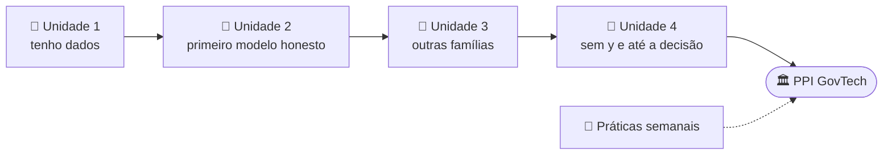

<div align="center">

# 🤖 AC: Aprendizagem Computacional

**IFMT Campus Várzea Grande · CST em Inteligência Artificial e Ciência de Dados · 4º semestre · 2026/2**


Apostila, notebooks que rodam no Colab sem configurar nada, práticas semanais e um projeto completo de exemplo para a PPI.<br>
Dados públicos de Mato Grosso e da gestão pública sempre que possível.

📘 [**Apostila do Aluno (PDF)**](apostila/Apostila_Aprendizagem_Computacional_Aluno_v2.pdf) · 🧪 [**Práticas semanais**](atividades) · 🗓️ [**Sprints da PPI**](ppi) · 🏛️ [**PPI-molde Comparece MT**](ppi_molde_comparece_mt)

</div>

---

## 🚀 Comece por aqui

1. **Abra a apostila** em [`apostila/Apostila_Aprendizagem_Computacional_Aluno_v2.pdf`](apostila/Apostila_Aprendizagem_Computacional_Aluno_v2.pdf). Cada capítulo diz qual notebook e qual seção rodar.
2. **Abra a prática da semana** em [`atividades`](atividades) e clique no botão **Open in Colab** do `LEIAME.md` dela.
3. **No Colab: Arquivo > Salvar uma cópia no Drive.** Sem isso, o que você fizer se perde ao fechar a aba.
4. **Complete os `# TODO`** de cima para baixo e rode a última célula, a de verificação, até aparecer tudo ✅.

---

## 🗂️ O que tem aqui

| Pasta | O que é | Para quê |
|---|---|---|
| 📘 [`apostila`](apostila) | A apostila (PDF e Word) e os 3 notebooks dos capítulos | Estudar a matéria com código que roda |
| 🧪 [`atividades`](atividades) | Uma pasta por prática semanal de laboratório | Praticar em aula, a partir de um notebook com `TODO` e verificação automática |
| 🗓️ [`ppi`](ppi) | Plano de sprints da PPI GovTech: MVP mínimo, calendário, checklist de cada terça, papéis, semáforo e planos B | Saber o que entregar em cada terça até a banca |
| 🏛️ [`ppi_molde_comparece_mt`](ppi_molde_comparece_mt) | Projeto completo de exemplo: previsão de abstenção, perfis de municípios, otimização com orçamento e dashboard | Modelo de repositório e de fluxo para a PPI GovTech |
| 📄 [`requirements.txt`](requirements.txt) | As bibliotecas usadas | Rodar no computador, fora do Colab |

---

## 📘 A apostila

São 4 unidades e 24 capítulos, mais 5 apêndices (guia de modelo e métrica, Weka, glossário, leituras e práticas semanais). Cada capítulo responde a uma pergunta que o anterior deixou aberta.

| Unidade | Capítulos | Assunto |
|---|---|---|
| **1 · Tenho dados: o que eles dizem?** | 1 a 4 | Aprender com dados, vocabulário, CRISP-DM, EDA |
| **2 · Meu primeiro modelo, provado com honestidade** | 5 a 10 | Treino/teste e baseline, preparação e vazamento, distâncias, regressão, logística e métricas, teoria |
| **3 · Outras famílias de modelos** | 11 a 16 | k-NN, Naive Bayes, árvores, SVM, redes neurais, ensembles e a comparação justa |
| **4 · Sem y, e até a decisão** | 17 a 24 | PCA, agrupamento (K-Means, misturas gaussianas, Fuzzy C-Means, SOM), anomalias e da previsão à decisão |

| Notebook | Capítulos | Abrir |
|---|---|---|
| `AC_U1_Dados_ao_Pipeline` | 1 a 7, 17 e 23 | [](https://colab.research.google.com/github/Schavess/ifmt-vg-ac/blob/main/apostila/notebooks/AC_U1_Dados_ao_Pipeline_INICIAL.ipynb) |
| `AC_U2_Supervisionada` | 5 e 8 a 16 | [](https://colab.research.google.com/github/Schavess/ifmt-vg-ac/blob/main/apostila/notebooks/AC_U2_Supervisionada_INICIAL.ipynb) |
| `AC_U3_Nao_Supervisionada` | 18 a 22 e 24 | [](https://colab.research.google.com/github/Schavess/ifmt-vg-ac/blob/main/apostila/notebooks/AC_U3_Nao_Supervisionada_INICIAL.ipynb) |

O mapa completo capítulo → seção do notebook está em [`apostila/LEIAME.md`](apostila/LEIAME.md).



Cada capítulo segue o mesmo roteiro: **De onde viemos → A ideia → Como funciona → No código → Armadilhas → No seu projeto → A pergunta que fica → Verifique**.
A seção "No seu projeto" liga o capítulo à PPI.

---

## 🧪 Práticas semanais

Toda semana pode entrar uma prática nova em [`atividades`](atividades), **e práticas extras também podem ser incluídas**, sempre no mesmo formato. O nome da pasta traz a data e o tema. As práticas constroem, um pedaço por semana, o [PPI-molde Comparece MT](ppi_molde_comparece_mt), uma semana antes de o grupo precisar daquele pedaço no projeto.

| Data | Prática | Apostila |
|---|---|---|
| 27/10 | [O problema: onde o eleitor de MT deixa de votar?](atividades/2026-10-27_Aula01_O_Problema) | cap. 1 a 4 |
| 03/11 | [Da fonte à base analítica: o ETL](atividades/2026-11-03_Aula02_ETL_Base_Analitica) | cap. 3, 4, 6 e 7 |
| 10/11 | [Experimento honesto: o modelo vence as duas réguas?](atividades/2026-11-10_Aula03_Experimento_Honesto) | cap. 5, 6 e 8 |
| 17/11 | [Qual modelo escolher? Validação cruzada, árvores e sobreajuste](atividades/2026-11-17_Aula04_Validacao_Cruzada_Arvores) | cap. 5, 10, 11, 13 e 16 |
| 24/11 | [Da previsão à decisão: perfis e carteira sob orçamento](atividades/2026-11-24_Aula05_Perfis_e_Decisao) | cap. 7, 17 a 19 e 24 |
| 01/12 | [Tribunal do Pipeline: auditar e consertar](atividades/2026-12-01_Aula06_Tribunal_do_Pipeline) | cap. 2, 5, 6, 9, 11 e 24 |
| … | *práticas extras podem entrar a qualquer semana, no mesmo formato* | |

```
atividades/AAAA-MM-DD_AulaNN_Tema/
├── LEIAME.md                ← leia primeiro: pergunta, objetivo, critérios, saída esperada
├── ..._INICIAL.ipynb        ← o notebook com # TODO que você completa
└── dados/                   ← CSV pequeno, quando precisa
```

A **última célula** de toda prática confere o seu resultado e mostra ✅ ou ❌ em cada item.

> 🔄 **Saiu prática nova?** Baixe o ZIP de novo ou rode `git pull`. Antes, salve os seus notebooks em outro lugar (ou no Drive).

---

## ▶️ Como abrir e rodar

### No Google Colab (o caminho principal)

Clique em qualquer botão  deste repositório. O notebook abre direto do GitHub, já com as bibliotecas instaladas.
Depois, **Arquivo > Salvar uma cópia no Drive** e trabalhe na sua cópia.

### No computador do laboratório (plano B, sem internet)

1. Baixe o repositório: botão verde **Code > Download ZIP** e extraia. Quem usa Git: `git clone https://github.com/Schavess/ifmt-vg-ac.git`.
2. Instale as bibliotecas **sem precisar de administrador**:

   ```powershell
   python -m pip install --user -r requirements.txt
   ```

   Prefere isolar? Use um ambiente virtual na sua pasta de usuário:

   ```powershell
   python -m venv $HOME\venv_ac
   & $HOME\venv_ac\Scripts\Activate.ps1
   python -m pip install -r requirements.txt
   ```

3. Abra o notebook com `python -m jupyter notebook` (ou no VS Code, com a extensão Jupyter) e rode as células de cima para baixo.

Os notebooks **não gravam nada dentro da pasta do repositório**. Quando algum gera arquivo, ele vai para `ac_saida`, dentro da sua pasta de usuário (no Colab, para `/content`), e o caminho aparece na saída.

---

## ❓ Dúvidas comuns

<details>
<summary><b>A primeira célula deu <code>HTTP Error 404</code> ou erro de conexão</b></summary>

O notebook tentou baixar o CSV do GitHub e não conseguiu. No Colab, clique no ícone de pasta (à esquerda), arraste o CSV da pasta `dados/` da prática para lá e rode a célula de novo. No laboratório, confira se a pasta `dados/` está ao lado do notebook.
</details>

<details>
<summary><b><code>NameError: name '...' is not defined</code></b></summary>

Uma célula anterior não foi rodada (ou o ambiente reiniciou). No Colab: **Ambiente de execução > Executar anteriores** e rode a sua célula de novo.
</details>

<details>
<summary><b><code>'NoneType' object has no attribute ...</code></b></summary>

A variável ainda está `None`: falta completar o `# TODO` em que ela nasce. Procure o TODO logo acima.
</details>

<details>
<summary><b>Os meus números não batem com a saída esperada</b></summary>

Confira o `random_state=42` (o `SEMENTE` do notebook), o `test_size` e o `stratify`. Com outro sorteio, os números mudam. Isso não quer dizer que o código esteja errado, mas a verificação não passa.
</details>

<details>
<summary><b>Fiz tudo no Colab, fechei a aba e perdi</b></summary>

O notebook aberto pelo botão é uma cópia temporária. Sempre faça **Arquivo > Salvar uma cópia no Drive** antes de começar.
</details>

<details>
<summary><b><code>pip install</code> pede administrador no laboratório</b></summary>

Use `python -m pip install --user -r requirements.txt` (instala na sua pasta de usuário) ou o ambiente virtual mostrado acima. Nunca é preciso instalar nada no Colab.
</details>


<details>
<summary><b>Onde estão as respostas?</b></summary>

As perguntas para discussão já trazem a "Resposta esperada" logo abaixo. As soluções completas dos `TODO` não são publicadas: a correção é feita em aula.
</details>

---

<div align="center">

**Prof. Arthur** · IFMT Campus Várzea Grande · 2026/2<br>
<sub>As soluções dos notebooks e das práticas não são publicadas neste repositório. Os dados usados são públicos e não contêm informação pessoal.</sub>

</div>
